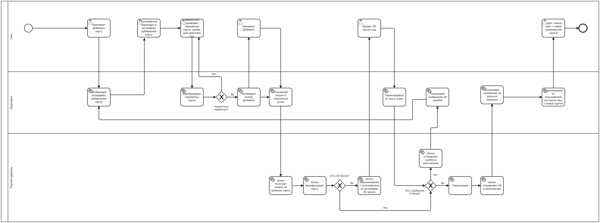

# Техническое задание: Функционал привязки карты

## 1. Бизнес-видение

Необходимо добавить в приложение возможность привязки платежной карты для автоматической оплаты поездки, так как это:

* Гарантирует, что поездка будет оплачена пассажиром. Соответственно, повысит прибыль, так как количество «зайцев» уменьшится.
* Ускорит высадку пассажиров, т.к. оплата будет произведена автоматически и пассажир, как и водитель, не будет терять время, расплачиваясь наличными. Это приведет к росту выполненных заказов и повышению прибыли.
* Увеличит привлекательность такси для пользователей, что также повысит прибыль.
---

## 2. Пользовательские требования
1. Пользователь должен иметь возможность зайти в раздел привязки карты для автоматической оплаты, нажав на опцию **«Добавить карту»** во вкладке **«Способы оплаты»**.
2. После нажатия опции **«Добавить карту»** Пользователю должен отображаться интерфейс, который позволяет вручную ввести:
    * Номер карты
    * Срок действия
    * CVC/CVV код
3. Пользователь должен иметь возможность видеть, что данные введены правильно.
4. **Считывание через NFC:** Пользователь должен иметь возможность считать параметры карты через NFC. 
    * *Реализация:* Добавить соответствующую иконку на интерфейс с пояснением о том, что необходимо поднести карту с NFC к телефону для автоматического распознавания. В этом случае поля «Номер карты» и «Срок действия» должны заполниться автоматически. "CVC/CVV" код **всегда** вводится Пользователем вручную.
5. **Считывание через камеру:** Пользователь должен иметь возможность считать параметры карты через камеру. 
    * *Реализация:* Добавить соответствующую иконку на интерфейс, которая бы включала камеру и автоматически считывала номер карты и срок действия, помещая их в соответствующие поля. "CVC/CVV" код **всегда** вводится Пользователем вручную.
6. После ввода параметров карты и при условии, что валидация параметров прошла успешно, должна активироваться кнопка **«Добавить»**. В случае ошибки кнопка не должна активироваться.
7. Пользователь должен нажать «Добавить», чтобы запустить процесс привязки карты.
8. Необходимо показать интерфейс **3D Secure**, чтобы пользователь имел возможность ввести код проверки, если этот метод защиты используется банком.
9. После успешной привязки карты пользователь должен быть перенаправлен на экран со списком карт, где отображается новая добавленная карта. Необходимо показать уведомление, что карта успешно добавлена.
10. В случае ошибки привязки пользователь должен остаться на интерфейсе добавления карты. Необходимо показать нотификацию об ошибке и предложить пользователю попробовать привязать карту еще раз.

---

## 3. Функциональные требования
1. Приложение должно позволять Пользователю войти в интерфейс добавления карты через опцию **«Добавить карту»**.
2. Приложение должно позволять Пользователю ввести данные карты (номер, срок действия, CVC) в интерфейсе добавления карты вручную, через NFC или камеру. CVC/СVV - строго вручную.
3. **Валидация данных:** Приложение должно валидировать введенные данные по следующим правилам:
    * **Номер карты:** длина от 16 до 19 цифр, соответствие алгоритму Луна
    * **Срок действия:** формат `ММ/ГГ`, дата не должна быть меньше текущей
    * **CVC/CVV:** ровно 3 цифры
    * *Обработка ошибок:* При невалидном значении кнопка «Добавить» блокируется, а некорректное поле подсвечивается красным цветом
4. Приложение не должно разрешать добавлять карту с некорректно введенными данными — необходимо блокировать функционал добавления в этом случае.
5. Приложение должно разрешать добавлять карту с корректно введенными данными — необходимо активировать кнопку добавления карты.
6. При запросе на добавление карты, исходя из введенных параметров, приложение должно отправлять запрос на привязку в банк-эквайер / банк-эмитент, к которому относится карта.
7. Приложение должно получить ответ от банка после запроса и активировать интерфейс 3D Secure для привязки карты, если это требуется банком.
8. Приложение должно ожидать положительный или отрицательный ответ банка на запрос о привязке карты.
9. В случае положительного ответа от банка Приложение должно добавить карту в список привязанных карт для данного пользователя и отобразить обновленный список.
10. В случае отрицательного ответа или отсутствия ответа Приложение должно нотифицировать пользователя о том, что привязка не удалась.

---

## 4. Нефункциональные требования
1. **Скорость работы интерфейса:** Открытие страницы добавления карты не должно превышать **0.5 сек**.
2. **Таймаут банковских операций:** Ожидание ответа от банка не должно превышать **15 сек**. Если время ожидания превышено, считается, что привязка не прошла, и приложение отображает ошибку. Рвем соединение и возвращаем 504 (Gateway timeout)


## 5. Архитектура процесса (BPMN)


## 4. Интеграционный контракт (API)
Для инициализации привязки карты Приложение выполняет запрос к Платежному шлюзу.

* **Метод:** POST
* **Эндпоинт:** /v1/bind_card
* **Заголовки:**
  * Content-Type: application/json
  * Authorization: Bearer [токен]

**Тело запроса (JSON):**
```json
{
  "user_id": "usr_77410",
  "card_number_masked": "4276**********44",
  "card_type": "VISA",
  "expiry_month": "12",
  "expiry_year": "2029",
  "payment_token": "token"
}
```
**Привязка удачная**

* При коде `200` (OK) приложение выводит: "Карта успешно добавлена."

**Обработка ошибок шлюза:**

* При коде `404` (Не найдено) приложение выводит: "Не удалось привязать карту. Попробуйте попозже еще раз."
* При коде `422` (Нет денег/Ошибка банка) приложение выводит: "Не удалось привязать карту. Попробуйте попозже еще раз."
* При коде `500` (Сбой шлюза) приложение выводит: "Не удалось привязать карту. Попробуйте попозже еще раз."
* При коде `504` (Gateway timeout) приложение выводит: "Не удалось привязать карту. Попробуйте попозже еще раз."

## 5. Структура хранения данных
Данные о картах пользователей сохраняются в реляционную БД.

* Таблица `users` содержит данные клиентов
    * id (string) — Primary Key
    * first_name (string) - имя
    * last_name (string) - фамилия
    * phone (string) - номер телефона

* Таблица `cards` содержит данные карт
    *  id (integer) - id карты в базе
    *  user_id (string) - Foreign key, связывает карту с таблицей `users`
    *  card_number (string) - замаскированный номер карты
